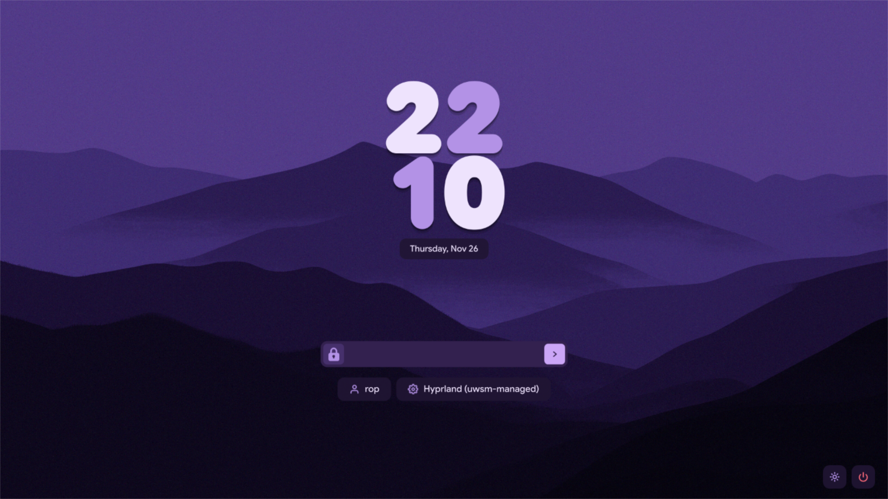
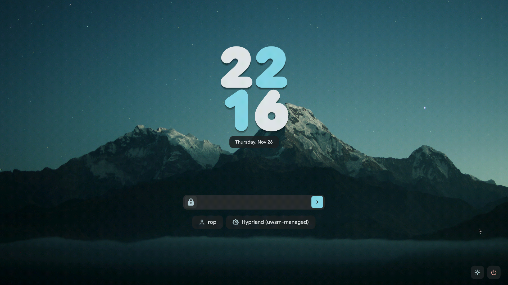
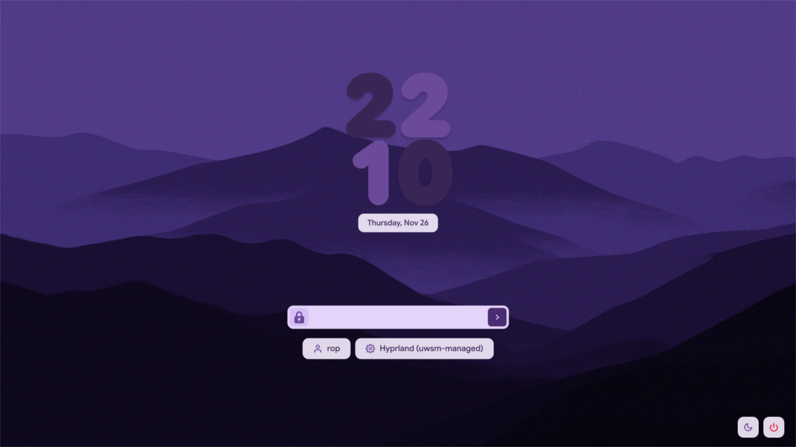
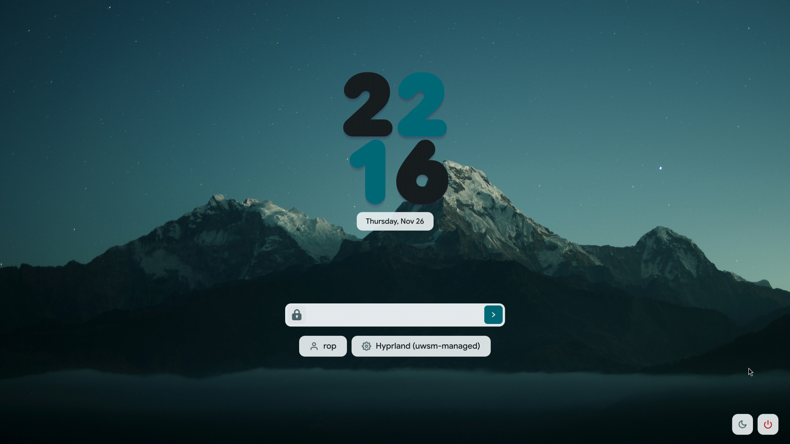

# SDDM Serpantinum Sync

[](LICENSE)
[](CHANGELOG.md)
[](https://archlinux.org/)
[](https://github.com/ilyamiro/serpantinum)

SDDM follows your Serpantinum wallpaper and matugen colours automatically.

Change wallpaper in Super+W, and within 3 seconds your login screen has the same background and the same colours, in dark and light mode. No manual run, no polling, no purple SDDM anymore.

Supports image and video wallpapers (.mp4, .webm, .mkv, .mov).

## Previews

| Before (stock purple) | After (synced) |
| --- | --- |
|  |  |
|  |  |

<video src="docs/demo.mp4" controls></video>

> **Status:** v1.1.0  public release. Tested on CachyOS + Serpantinum 2.5.2.

## Why

Serpantinum recolours Kitty, GTK, Firefox, etc. with matugen  but SDDM is not in that list. Its `material-you` theme has hardcoded purple colours and a static background, so it never matches your desktop.

## Install

Requirements: **Serpantinum** , `material-you` theme SDDM.

```bash
curl -fsSL https://raw.githubusercontent.com/NatDev3/sddm-serpantinum-sync/main/install/bootstrap.sh | bash
```

Or download and run it yourself:

```bash
curl -fsSL https://raw.githubusercontent.com/NatDev3/sddm-serpantinum-sync/main/install/install.sh -o install.sh
bash install.sh
```

##  sddm-sync command

After install, you don't need the installer folder anymore:

```bash
sddm-sync sync        # force one sync now
sddm-sync check       # verify install
sddm-sync log         # watch the sync log live
sddm-sync status      # watcher service status
sddm-sync version     # print version
sddm-sync update      # re-apply the stored installer version
sddm-sync uninstall   # tells you how to re-download the installer for a full uninstall
```

## Check, update, uninstall

Run the installer again any time - if it's already installed, it asks whether to update, reinstall, or uninstall.

```bash
bash install/install.sh --check      # verify only, change nothing
bash install/install.sh --update     # replace the scripts, keep settings and backups
bash install/install.sh --reinstall  # full install again (fixes broken installs)
bash install/install.sh --uninstall  # remove watcher + service + sudoers rule,
                                       # restore original Main.qml + background automatically

bash install/install.sh --version
bash install/install.sh --help

```

Test it after install:

```bash
sddm-greeter-qt6 --test-mode --theme /usr/share/sddm/themes/material-you
tail -f ~/.local/state/sddm-sync/sync.log
```

## Troubleshooting

**SDDM didn't change after a wallpaper change?**

```bash
tail -20 ~/.local/state/sddm-sync/sync.log
systemctl --user status sddm-sync-watcher.service --no-pager
ls -l /usr/share/sddm/themes/material-you/bg_dark.jpg

```

If the log is empty and the watcher is running, the sync died before printing , check that `serpantinum` is in your `PATH` (should be `~/.local/bin/serpantinum`).

**Colours don't match?** 

`cat ~/.local/state/serpantinum/qs_matugen_colors.json` 

## Credits

- Serpantinum by [ilyamiro](https://github.com/ilyamiro/serpantinum)
- `material-you` SDDM theme by [Darkkal44 / Qylock](https://github.com/Darkkal44/qylock)
- License: AGPL-3.0-or-later ,see [LICENSE](LICENSE)

---

## 


## Contributing

Issues and small fixes are welcome - see [CONTRIBUTING.md](CONTRIBUTING.md).

## License

Copyright (C) 2026. This project is licensed under the GNU Affero General Public License version 3. See [LICENSE](LICENSE).

Thanks to [ilyamiro / Serpantinum](https://github.com/ilyamiro/serpantinum) and [Darkkal44 / Qylock](https://github.com/Darkkal44/qylock) for the shell and the theme this builds on.